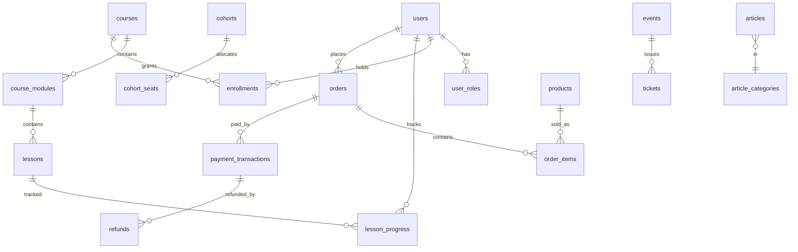

# Data model (PostgreSQL, proposed — no database created yet)

Conventions: `uuid` PKs (`gen_random_uuid()`), `created_at/updated_at timestamptz default now()`, money as `amount_minor bigint` + `currency char(3)`, soft states via enums, FK `on delete restrict` for financial rows.

| Table | Key columns | Constraints / indexes |
|---|---|---|
| `users` | id, email, display_name, auth_provider_id | UNIQUE(lower(email)) |
| `user_roles` | user_id, role(enum student/coach/admin) | PK(user_id, role) |
| `courses` | id, slug, title, level, status, price_minor, currency | UNIQUE(slug); idx(status) |
| `course_modules`, `lessons` | course_id/module_id, position, video_asset_id | UNIQUE(parent, position) |
| `enrollments` | user_id, course_id, status, source, granted_at, order_id | **UNIQUE(user_id, course_id)** |
| `lesson_progress` | user_id, lesson_id, position_seconds, completed_at | PK(user_id, lesson_id) |
| `cohorts` / `cohort_seats` | starts_at, seats_total / cohort_id, user_id | UNIQUE(cohort_id, user_id); CHECK seats |
| `coaching_applications` / `coaching_sessions` | user/lead, status, scheduled_at | idx(status) |
| `orders` / `order_items` | user_id, status, total_minor, currency / item_type, item_id, unit_minor, qty | idx(user_id, created_at desc) |
| `payment_transactions` | order_id, provider, provider_ref, status, amount_minor | **UNIQUE(provider, provider_ref)** |
| `refunds` | transaction_id, amount_minor, reason, status | CHECK amount ≤ paid |
| `products` / `inventory` | slug, price / product_id, quantity | UNIQUE(slug); CHECK qty ≥ 0 |
| `events` / `tickets` | slug, starts_at, capacity / event_id, user_id, code | UNIQUE(code) |
| `articles` / `article_categories` | slug, status, published_at | UNIQUE(slug); idx(status, published_at desc) |
| `form_submissions` | kind, payload jsonb, email, ip_hash, status | idx(kind, created_at) |
| `notifications` | user_id, type, read_at | idx(user_id, read_at) |
| `webhook_events` | provider, event_id, payload, processed_at | **UNIQUE(provider, event_id)** — idempotency |
| `audit_logs` | actor_id, action, entity, entity_id, diff jsonb | append-only; idx(entity, entity_id) |
| `broker_links` (optional) | user_id, broker, account_ref, verified_at | requires compliance review |

Migrations will live in `supabase/migrations` or `drizzle/` once ADR-002 is decided.
