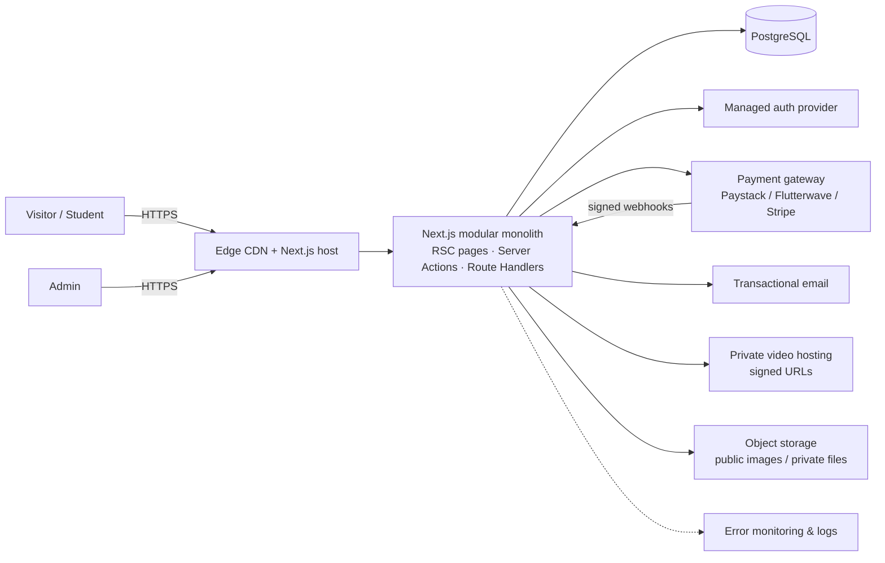

# System overview

## Requirements
**Functional (phased):** public marketing & SEO pages; lead/inquiry forms; accounts & roles; course catalogue, enrollments, lessons, progress; coaching applications; cohorts; events & tickets; shop & orders; payments & refunds; admin CMS/reporting; notifications.

**Non-functional:** mobile-first responsive UI; WCAG 2.2 AA intent; Core Web Vitals goals LCP ≤ 2.5 s, CLS ≤ 0.1, INP ≤ 200 ms (p75); strong consistency for money/entitlements; privacy-aware analytics; secrets isolated per environment; observable errors.

**Rough estimates (assumptions, to validate):** launch ≤ 50k monthly visitors, ≤ 5k registered students in year one, video is the dominant bandwidth cost (hosted by a video provider, not our servers). This is comfortably single-region monolith territory.

## Context diagram

_Everything right of APP is Phase 1+ and not yet integrated._

## Request paths
- **Public page:** prerendered HTML from CDN → hydrate small client islands (menu, accordions, forms, motion).
- **Form:** browser Zod check → Server Action → Zod check → (future) rate limit → persist → notify. Today returns `not_configured`.
- **Purchase (future):** see ADR-003.
- **Lesson (future):** dashboard server component → session → entitlement query → signed video URL (short TTL).
